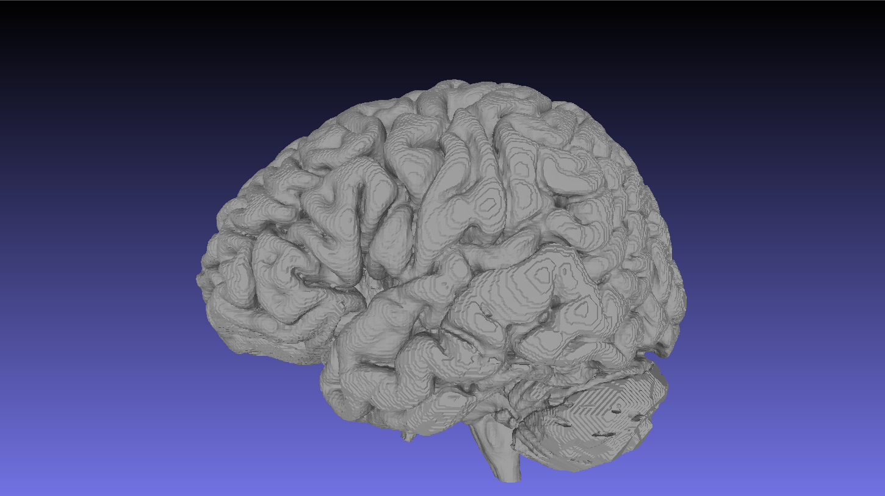
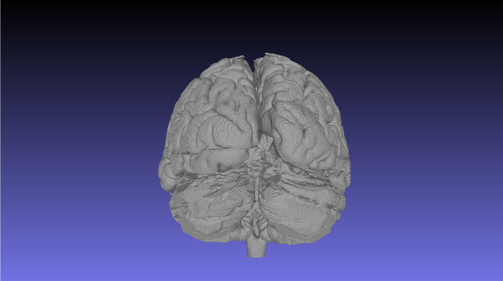

## Marching Cubes

This is a C++ implementation of the Marching Cubes algorithm [1] adapted from [2].

The Marching Cubes algorithm is a computer graphics algorithm to extract a polygonal mesh (in this implementation, a triangular mesh) of an isosurface from a three-dimensional discrete scalar field.

A three-dimensional scalar field can be specified as a txt file in the format specified below and the triangular mesh is obtained in the Stanford PLY file format [3] which can be visualized using any mesh visualizer such as Paraview, Blender, etc.

### Usage

The driver file is `src/main_march.cpp`. A C++11 compiler and CMake 3.15 or newer are required. On Windows, install Visual Studio Build Tools with the **Desktop development with C++** workload (or another C++ toolchain supported by CMake), then run these commands from the project directory:

```shell
cmake -S . -B build
cmake --build build --config Release
```

Run the generated executable with an input path, output path, and isovalue. For a Visual Studio generator on Windows:

```powershell
.\build\Release\main_march.exe <inp_file_path> <out_file_path> <float_isovalue>
```

For single-configuration generators such as MinGW Makefiles or Unix Makefiles, the executable is typically `build/main_march` (or `build/main_march.exe` on Windows). The program reads the scalar field from `<inp_file_path>` and writes the isosurface as a PLY file to `<out_file_path>`.

In VS Code, use **Terminal > Run Build Task** to configure and build the project.

##### Example Usage

```shell
cmake -S . -B build
cmake --build build --config Release
```

Then run `main_march` with `data/txt_in/healthy_brain.txt`, `data/ply_out/healthy_brain_72.ply`, and `72.0` as its three arguments.

##### Input File Format

The input scalar field can be specified as a grid in a text file. The text file contains as many lines as there are number of points in the 3D grid. Each line of the text file is of the following format:
```
x y z value
```
where `x,y,z` specify the location in the grid and `value` assigns a functional value to that location.

### Sampling an external SDF (ReactPhysics3D)

`MarchingCubes::triangulate_grid()` samples a regular scalar grid through a callback, so callers do not need to serialize the SDF or construct the nested array themselves. For a `ConcaveMeshShape` whose SDF has already been generated, include the ReactPhysics3D and Marching Cubes headers and call it like this:

```cpp
const auto& sdf = concaveShape.getSDF();
const auto& resolution = sdf.resolution();
const auto min = sdf.domain().getMin();
const auto cellSize = sdf.cellSize();

MarchingCubes marchingCubes;
auto triangles = marchingCubes.triangulate_grid(
	resolution[0], resolution[1], resolution[2],
	Point{static_cast<float>(min.x), static_cast<float>(min.y), static_cast<float>(min.z)},
	Point{static_cast<float>(cellSize.x), static_cast<float>(cellSize.y), static_cast<float>(cellSize.z)},
	0.0f,
	[&sdf](float x, float y, float z) {
		return static_cast<float>(sdf.interpolate(
			0,
			reactphysics3d::Vector3(
				static_cast<reactphysics3d::decimal>(x),
				static_cast<reactphysics3d::decimal>(y),
				static_cast<reactphysics3d::decimal>(z))));
	});
```

The grid resolution is the number of cells per axis; the sampler automatically evaluates `resolution + 1` nodes on each axis. Extracted `Point` coordinates are in the SDF domain's local coordinate system, and `0.0f` extracts the zero level set. This project exposes the algorithm as the `marching_cubes` CMake library target. In a consuming CMake project, add this repository with `add_subdirectory(...)` and link that target; also link ReactPhysics3D. Do not include this project's standalone `main_march.cpp` in the consuming target. Use a closed mesh for reliable signed distances, and increase the SDF resolution if the extracted surface is too coarse.

### Demo

The following images are obtained by running this implementation on a scalar field obtained from the MRI scan of the human brain.





### References

[1] Lorensen, William E., and Harvey E. Cline. “Marching Cubes: A High Resolution 3D Surface Construction Algorithm.” Proceedings of the 14th Annual Conference on Computer Graphics and Interactive Techniques  - SIGGRAPH '87, 1987, doi:10.1145/37401.37422. 

[2] Brooke, Paul. “Polygonising a Scalar Field.” Polygonising a Scalar Field (Marching Cubes), paulbourke.net/geometry/polygonise/. 

[3] Brooke, Paul. PLY - Polygon File Format, paulbourke.net/dataformats/ply/.
